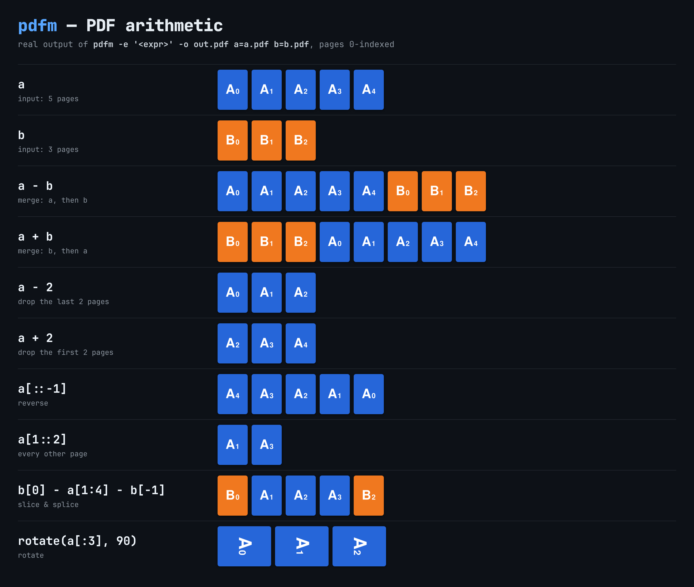
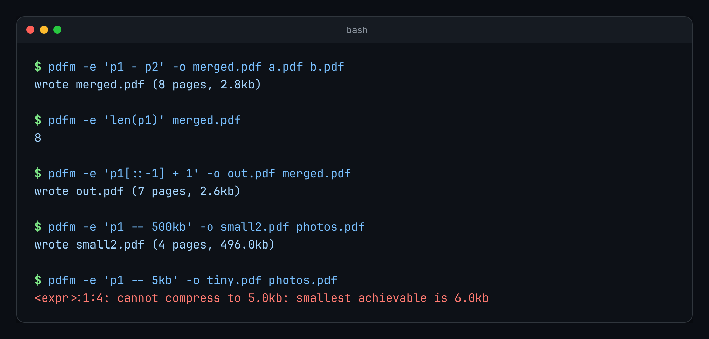
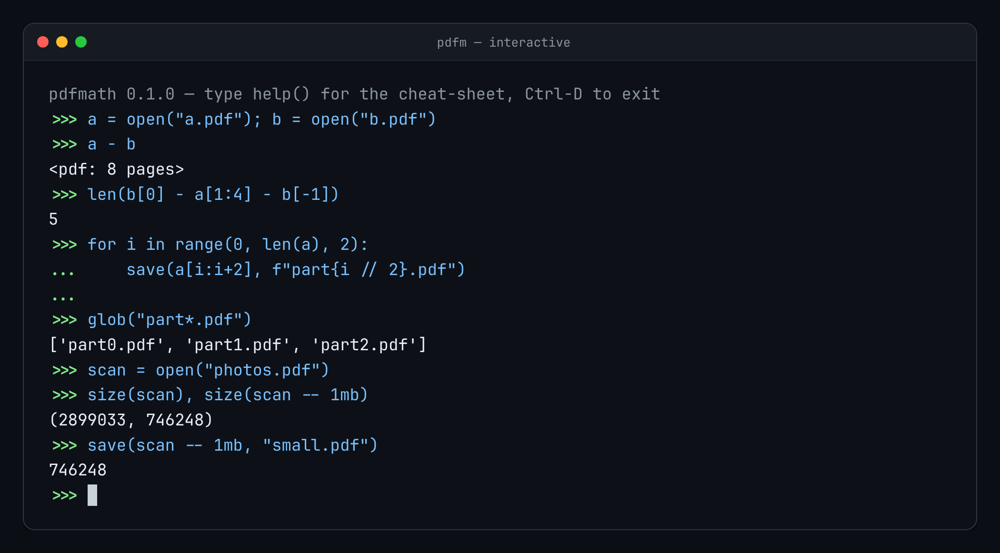

# pdfmath (`pdfm`)

PDF arithmetic on the command line. You merge, cut, slice, rotate and compress PDFs with
operators and Python slicing. A Python-like scripting language and an interactive `>>>`
prompt are included. It is a single static binary that runs fully offline.



```sh
pdfm -e 'p1 - p2' -o merged.pdf a.pdf b.pdf     # a then b
pdfm -e 'p1[::-1] - 1' -o out.pdf a.pdf         # reversed, without its last page
pdfm -e 'p1 -- 2mb' -o small.pdf scan.pdf       # compress to <= 2 MiB
```

## Install

```sh
npm install -g @awryhant/pdfmath
# or build from source (Rust 1.88+):
cargo install --locked --git https://github.com/arihant1602/pdfmath
```

npm ships prebuilt binaries for Linux, macOS and Windows on x64 and arm64.
You don't need Node or Rust at runtime.

### Use it from AI agents (MCP)

`pdfm mcp` is a built-in [MCP](https://modelcontextprotocol.io) server. Once it is registered,
your agent edits PDFs through tool calls (`pdf_info`, `pdf_eval`, `pdf_script`) whenever a task
needs it:

```sh
claude mcp add --scope user pdfmath -- pdfm mcp     # Claude Code
codex mcp add pdfmath -- pdfm mcp                   # Codex CLI
```


Setup for Cursor, Claude Desktop, Gemini CLI and other clients is in **[docs/mcp.md](docs/mcp.md)**.

### Let your AI agent install it

Paste the prompt from **[docs/AGENT_PROMPT.md](docs/AGENT_PROMPT.md)** into Claude Code, Codex,
Cursor or a similar agent. It installs `pdfm`, registers the MCP server, checks that it works, and
learns the syntax. After that you can ask for things like "merge these, drop the cover, and get it under 5 MB".

## Operators

Pages are 0-indexed, as in Python.

| Expression | Result |
|---|---|
| `a - b` | merge: a's pages, then b's |
| `a + b` | merge: b's pages, then a's |
| `p - n` | drop the **last** n pages |
| `p + n` | drop the **first** n pages |
| `p * n` | repeat p n times |
| `p -- 2mb` | compress until the file is **≤ 2mb** (units `b`, `kb`, `mb`, `gb`; 1kb = 1024 bytes) |
| `p[i]`, `p[-1]` | a single page |
| `p[a:b:c]` | Python slicing: `p[::-1]` reverses, `p[::2]` keeps every other page, `p[1:-1]` trims both ends |
| `p[i] = q`, `p[a:b] = q`, `del p[::2]` | Python list assignment and deletion |
| `len(p)` | page count |
| `q in p` | True if all of q's pages are in p |

How `--` works:
1. It first tries lossless steps: recompressing streams, removing duplicate objects, and packing objects into object streams.
2. If that is not enough, it re-encodes the images as JPEG. It searches for the mildest quality and scale setting that fits the target.
3. The size is measured on the real output, so the file it saves is never larger than the target.
4. If the target cannot be reached, for example with a PDF that is all text, it fails with an error that names the smallest size it managed.

Write `p - -2` with a space if you really mean minus negative two.

## Command line

```
pdfm                          interactive >>> prompt (runs stdin as a script when piped)
pdfm script.pm [ARGS...]      run a script; ARGS are in the list `args`
pdfm -c CODE [ARGS...]        run code from a string
pdfm -e EXPR [-o OUT] FILES   evaluate one expression; FILES are bound to p1, p2, ...
                              (or NAME=path.pdf binds NAME); -o saves the resulting pdf
pdfm -i script.pm             run a script, then stay in the prompt
pdfm -                        read a script from stdin
pdfm --help-lang              language cheat-sheet
```



```sh
pdfm -e 'p1 + p2' -o out.pdf a.pdf b.pdf             # b then a
pdfm -e 'p1[::-1]' -o reversed.pdf a.pdf
pdfm -e 'p1 + 1 - 1' -o trimmed.pdf a.pdf            # drop first and last page
pdfm -e 'cover - body[2:10]' -o out.pdf cover=c.pdf body=b.pdf
pdfm -e 'p1 -- 500kb' -o small.pdf scan.pdf
pdfm -e 'len(p1)' a.pdf                              # prints 12
```

## Interactive prompt



```
>>> a = open("report.pdf")
>>> a
<pdf: 12 pages>
>>> for i in range(0, len(a), 4):
...     save(a[i:i+4], f"part{i // 4}.pdf")
...
>>> info(a[::-1] - 2)
```

A line that ends in `:`, or that leaves a bracket open, continues on a `...` line. A blank
line runs the block. History is kept in `~/.pdfm_history`.

## Scripts (`.pm`)

`.pm` files use Python syntax and semantics:
- control flow: `if`/`elif`/`else`, `while`, `for`, `break`, `continue`
- functions: `def` with default and keyword arguments, `return`, `lambda`
- `global`, list comprehensions, tuple unpacking, f-strings with format specs, and `%` formatting
- the types `int`, `float`, `str`, `bool`, `list`, `tuple` and `None`, with the common string and list methods
- builtins: `print`, `len`, `range`, `sorted`, `enumerate`, `zip`, `min`, `max`, `sum`, `map`, `filter`, `any`, `all`, `round`, `abs`, `isinstance`, `input`, `exit`

Dicts, classes, `import` and exceptions (`try`) are not supported.

PDF builtins:

| Function | |
|---|---|
| `open(path, password=None)` | load a pdf |
| `save(p, path)` / `p.save(path)` | write it; returns the number of bytes written |
| `rotate(p, 90)` / `p.rotate(90)` | rotate every page clockwise (any multiple of 90) |
| `reverse(p)` | reverse the page order |
| `blank(n=1, width=595, height=842)` | n empty pages (A4, in points) |
| `info(p)` | print the page count, source files and page sizes |
| `size(p)` | the size in bytes it would have when saved |
| `pages(p)` / `list(p)` | a list of single-page pdfs |
| `compress(p, size)` | same as `p -- size` |
| `glob("dir/*.pdf")`, `exists(path)` | find files (sorted) |
| `run("other.pm")` | run another script in the same session |

```python
# merge every pdf in a folder, then compress the result
files = glob(args[0] + "/*.pdf")
out = open(files[0])
for f in files[1:]:
    out = out - open(f)
save(out -- 5mb, "all.pdf")
```

PDF values are cheap: slicing and merging only shuffle page references, and the file is
built only when you save. Pages keep their content, fonts, images, annotations and links.
Document-level data (outlines/bookmarks, forms, the structure tree) is not carried over.

## For AI agents and scripts

- Prefer the MCP server (`pdfm mcp`, see [docs/mcp.md](docs/mcp.md)). Otherwise you don't need a prompt: use `pdfm -e`, `pdfm -c`, `pdfm file.pm` or `echo '...' | pdfm -`.
- The exit code is 0 on success and 1 on error. `exit(n)` sets it.
- Errors go to stderr as `origin:line:col: Kind: message`, for example `job.pm:3:9: NameError: name 'x' is not defined`.
- `-e … -o out.pdf` prints one line: `wrote out.pdf (N pages, SIZE)`.
- Use `pdfm -e 'len(p1)' file.pdf` to get a page count, and `pdfm -e 'info(p1)' file.pdf` for details.
- Nothing touches the network.
- Agent-facing notes are in [AGENTS.md](AGENTS.md). The full language reference is in [docs/language.md](docs/language.md).

## Building from source

```sh
cargo build --release     # target/release/pdfm
cargo test
cargo clippy --all-targets -- -D warnings
```

npm packaging: `npm/pdfmath` is a small Node launcher, published as `@awryhant/pdfmath`. For each platform there is an
optional package (`pdfmath-linux-x64`, `pdfmath-darwin-arm64`, `pdfmath-windows-x64`, …) that
holds the binary. `.github/workflows/release.yml` builds all of them and publishes them when
a `v*` tag is pushed. It needs the `NPM_TOKEN` secret.

## License

MIT. See [LICENSE](LICENSE).
