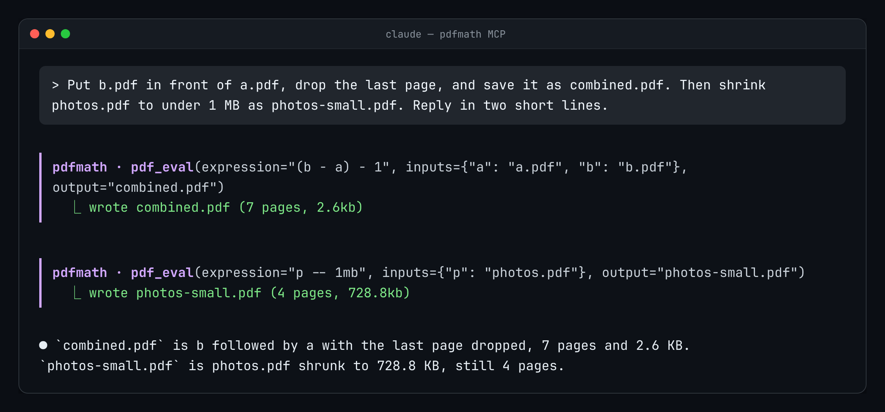

# MCP server

`pdfm mcp` runs pdfmath as a [Model Context Protocol](https://modelcontextprotocol.io) server
on stdio. Any MCP client (Claude Code, Claude Desktop, Codex, Cursor, Gemini CLI, …) can then
edit PDFs through tool calls whenever a task needs it. Everything runs locally and offline.



## Register it

Install first (`npm install -g @awryhant/pdfmath`, or see the [README](../README.md#install)).

| Client | Command or config |
|---|---|
| Claude Code | `claude mcp add --scope user pdfmath -- pdfm mcp` |
| Codex CLI | `codex mcp add pdfmath -- pdfm mcp` |
| Gemini CLI | `gemini mcp add pdfmath pdfm mcp` |
| Cursor (`~/.cursor/mcp.json`), Claude Desktop (`claude_desktop_config.json`), others | see the JSON below |

```json
{
  "mcpServers": {
    "pdfmath": { "command": "pdfm", "args": ["mcp"] }
  }
}
```

If you'd rather not install it globally, use `"command": "npx", "args": ["-y", "@awryhant/pdfmath", "mcp"]`.
Restart the client or start a new session after registering.

## Tools

| Tool | What it does | Main arguments |
|---|---|---|
| `pdf_info` | page count, page sizes and file size (read-only) | `path`, `password?` |
| `pdf_eval` | one expression over named inputs, optionally saved | `expression`, `inputs` `{name: path}`, `output?`, `overwrite?` |
| `pdf_script` | a multi-line `.pm` program; returns what it prints | `code`, `args?` |

All three tools accept `cwd`, and relative paths are resolved against it. If you leave it out,
paths are relative to the directory the client started the server in.

Example calls:

```json
{"name": "pdf_eval", "arguments": {"expression": "a - b[2:]", "inputs": {"a": "report.pdf", "b": "annex.pdf"}, "output": "merged.pdf"}}
{"name": "pdf_eval", "arguments": {"expression": "a -- 2mb", "inputs": {"a": "scan.pdf"}, "output": "scan-small.pdf"}}
{"name": "pdf_eval", "arguments": {"expression": "len(a)", "inputs": {"a": "report.pdf"}}}
{"name": "pdf_script", "arguments": {"code": "out = blank(0)\nfor f in glob('in/*.pdf'):\n    out = out - open(f)\nprint(save(out, 'all.pdf'))"}}
```

`pdf_eval` replies with `wrote merged.pdf (12 pages, 1.40mb)`, or with the value of the
expression. A failure sets `isError: true`, and the message names the line and column.

## Safety

- **No overwriting by default:** `pdf_eval` only writes `output`, and refuses if that file already exists (an input or anything else) unless `overwrite: true` is passed. Its tool description tells agents to set that only when the user asked.
- **No writes from the expression:** `pdf_eval` expressions cannot call `save()`, `run()`, `exit()` or `input()`, so the tool really is non-destructive. Jobs that need several writes go through `pdf_script`, which is marked destructive so clients can ask for confirmation.
- **`exit()` is contained:** in a script it ends that program only, never the server. `input()` is disabled.
- **No network:** the server never touches it. It reads and writes only the paths the tools are given (and whatever a script opens or saves).

## Protocol details

- **Messages:** newline-delimited JSON-RPC 2.0 on stdin and stdout. Batches are accepted, and nothing but protocol messages is ever written to stdout.
- **Methods:**
  - `initialize`: echoes the client's `protocolVersion` and advertises `tools` along with server `instructions`.
  - Also supported: `ping`, `tools/list`, `tools/call`, plus empty replies to `resources/list` and `prompts/list`.
- **Requests run one at a time.**

Try it by hand:

```sh
printf '%s\n' '{"jsonrpc":"2.0","id":1,"method":"tools/list"}' | pdfm mcp
```
